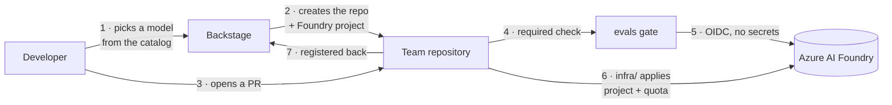

# Azure AI Foundry + Backstage

> A model catalog is not a platform. A platform is what still works when the platform team is not in the room.

Reference architecture and runnable demo for the talk **"Azure AI Foundry + Backstage"**
(NetCoreConf Barcelona, 12 December 2026).

This repository is not a product. It is the answer to one question:

**When the fourth team builds an AI application, what do they get for free and what do they still have to decide?**

The answer is a golden path and a gate. Everything here exists to make those two things concrete.

---

## The shape of it



## Who owns what

The talk spends ten minutes on this table. It is the whole argument.

| Piece | Owns | Does **not** own |
|---|---|---|
| **Azure AI Foundry** | the resource (network, security, model deployments), projects, quotas, OTel traces to App Insights, evaluations | who owns the repository, whether the team follows the rules, when a release may ship |
| **Backstage** | the catalog (owner, dependencies) and the template that creates the repo | deployments, evaluations. There is **no official Foundry plugin** — the Azure scaffolder module publishes to Azure DevOps, so the action is yours to write |
| **GitHub** | the generated repo, the PR, the required check, federated OIDC to Azure | which model to use. It executes what you tell it |
| **APIM (GenAI gateway)** | token-based TPM per consumer, chargeback per team/project | model quality |

> The portal tells you what exists. The repository tells you what is allowed.

## Repository layout

```
platform/      what the platform team owns (template, IaC, gateway policy)
demo/          one instance of the golden path, with the gate running
docs/          the reference architecture, one decision per file
```

`platform/` versus `demo/` is not folder hygiene. It is the boundary the talk is about:
one side is the product the platform team maintains, the other is what a team receives
and is allowed to change.

## Run it

Requires Python 3.11+. Nothing else. No Azure subscription, no credentials.

```bash
make demo
```

That runs the evaluation gate over 20 meeting transcripts in **replay mode** — recorded
model responses, no network, deterministic, a few seconds. It should pass.

```bash
git checkout demo/gate-fails
make demo
```

That is the other demo: a cheaper prompt, one metric below threshold, exit code 1. This is
what a required check looks like when it is actually required.

To run it against a real deployment:

```bash
cp .env.example .env      # then fill it in
make record               # re-record fixtures against your Foundry deployment
make demo LIVE=1
```

## What is in `demo/ai-actas-bot`

A meeting-minutes agent. Transcription in, structured minutes out: summary, decisions
with rationale, action items with an owner. It was chosen because the output is checkable
by a human in ten seconds, which is what a demo needs.

| Metric | Kind | Why it is in the gate |
|---|---|---|
| `schema_valid` | deterministic | a broken contract is not a quality debate |
| `decisions_recall` | fuzzy match | did it capture what was actually decided |
| `owner_accuracy` | deterministic | the most common real failure: right task, wrong person |
| `invented_owners` | deterministic | hallucinated names are the failure mode that costs trust |

Latency and token cost are **reported, not gated**. They answer a different question —
the business one — and they belong to the attribution story, not to correctness.

## Disclaimer

The fixtures in `demo/ai-actas-bot/evals/fixtures/` are **synthetic**: this repository was
built without an Azure subscription. They exist so the gate is runnable offline and
deterministic. `make record` replaces them with real model output. No customer data, no
internal figures, no credentials anywhere in this repo.

MIT licensed. See `NOTICE`.
