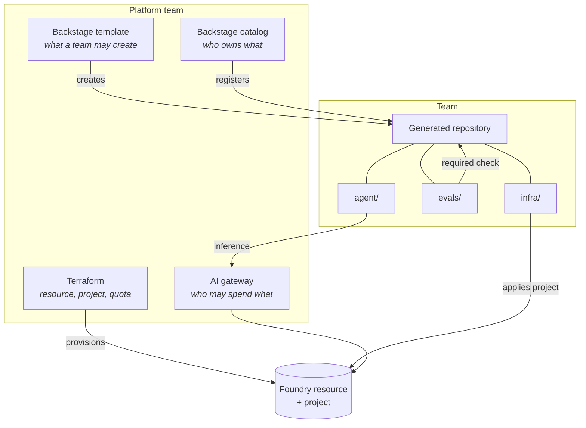

# 00 · The reference architecture

Five components, one boundary each. The whole design is the argument that no component
should know more than it needs to.

## The three boundaries

**The Foundry resource is a governance boundary.** Networking, encryption, model
deployments, quota. It is owned by the platform team and a team should never create one.

**The Foundry project is a development boundary.** The team's agents, datasets, indexes,
evaluations. Teams consume projects, they do not own resources.

**The repository is an accountability boundary.** It says who owns the workload, which
model it is allowed to call, and what has to be true before a change ships. Foundry cannot
see this. Backstage can.

Confusing the first two is the expensive mistake: it produces either a shared project where
nobody knows whose quota was consumed, or a resource per team where the platform team has
lost control of egress and identity.

## What each piece is allowed to decide

| Decision | Decided by | Why there |
|---|---|---|
| Which model may be used | platform team, in the catalog | it is a cost and compliance decision |
| Which prompt a team writes | the team, in the repo | it is their domain knowledge |
| Whether a change may merge | the pipeline, deterministically | see [04](04-the-gate.md) |
| Which environment exists | platform team, by template | environments are infrastructure |
| Who pays for what | gateway, by caller identity | see [05](05-attribution.md) |

## The sentence that keeps the design honest

> The portal tells you what exists. The repository tells you what is allowed.

Backstage is a catalog with a form attached. It is not a control plane and it should not
become one: the moment the portal is the only place a rule exists, the rule is unversioned,
untested and invisible in a pull request.

## What is deliberately missing

- **No shared project per team.** A project per team is a project per environment; one
  project shared by everyone is flat RBAC and a shared quota.
- **No deployment from the portal.** The template creates a repository. From there,
  delivery is the team's pipeline, not the platform team's button.
- **No official Foundry plugin in Backstage.** The Azure scaffolder module publishes to
  Azure DevOps. The action that talks to Foundry is written by the platform team — which is
  the honest way to say it in the talk: it is a small action, and it is yours.
